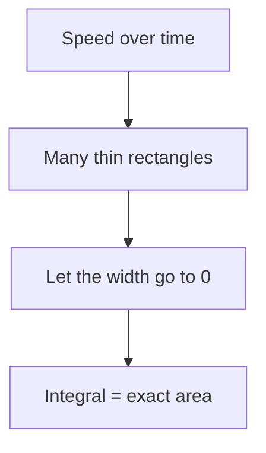

# What is the area under a curve?

Imagine you drive a car. Your speed changes over time. **How far did you go?**

If the speed were constant, distance is easy: $\text{distance} = \text{speed} \times \text{time}$. When the speed changes, we chop time into tiny slices, treat the speed as constant in each slice, and add them all up.

> **Big idea:** the area under the speed curve *is* the distance travelled.

## Chopping into rectangles

Split $[a, b]$ into $n$ slices of width $\Delta x = \frac{b-a}{n}$. Each rectangle has height $f(x_i)$, so the total is

$$
S_n = \sum_{i=1}^{n} f(x_i)\,\Delta x
$$

As $n \to \infty$ the rectangles hug the curve perfectly, and we get the **definite integral**:

$$
\int_a^b f(x)\,dx = \lim_{n\to\infty} \sum_{i=1}^{n} f(x_i)\,\Delta x
$$

In C++ terms, this is just a loop:

```cpp
double area(double a, double b, int n) {
    double dx = (b - a) / n, sum = 0;
    for (int i = 0; i < n; ++i) sum += f(a + i * dx) * dx;
    return sum;   // gets closer to the integral as n grows
}
```

## See it

The shaded part is $\int_0^2 x^2\,dx$. Try the [Riemann sum explorer](riemann-explorer.html) to watch the rectangles fill it.

```plot
{"title": "Area under y = x²", "domain": [-1, 3], "functions": [{"expr": "x^2", "label": "y = x²"}], "area": {"expr": "x^2", "from": 0, "to": 2}}
```

## How the pieces connect



## Check yourself

```quiz
{"questions": [
  {"question": "What does $\\int_0^3 2\\,dx$ equal?", "options": ["2", "3", "6", "9"], "answer": 2, "explanation": "It is a rectangle of height 2 and width 3, so the area is $2 \\cdot 3 = 6$."},
  {"question": "More rectangles make the estimate…", "options": ["worse", "closer to the true area", "always exactly right"], "answer": 1, "explanation": "Thinner rectangles hug the curve better, so the sum approaches the integral."}
]}
```

Next: [practice quiz](02-practice.quiz.json).
