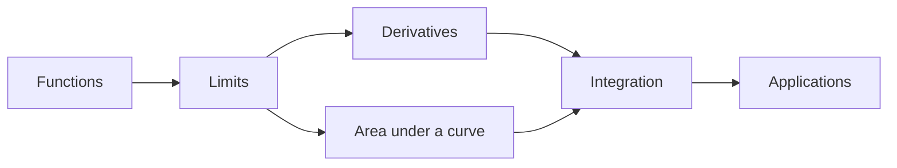

# Math

Your map for math. Start at the top and follow the arrows: each idea rests on the one before it.

## What you already have

- Variables, functions and loops from **C++**: a math function $f(x)$ is a lot like a C++ function `double f(double x)`. Same idea, different notation.
- Basic algebra: you can solve $2x + 3 = 7$.

## Where we are going

## Materials

| Step | Material | Kind |
|---|---|---|
| 1 | [Moving functions around](Functions/transformations.plot.json) | interactive graph |
| 2 | [What is area under a curve?](Integrals/01-what-is-area.md) | notes |
| 3 | [Quick check: area](Integrals/02-practice.quiz.json) | quiz |
| 4 | [Integral flashcards](Integrals/03-cards.flash.json) | flashcards |
| 5 | [See the area](Integrals/04-area.plot.json) | graph |
| 6 | [Integration lab](Integrals/05-integration.lab.json) | practice lab |
| 7 | [Riemann sum explorer](Integrals/riemann-explorer.html) | mini app |

## Next up

Once the lab feels easy: the **Fundamental Theorem of Calculus**, which says integration undoes differentiation.
